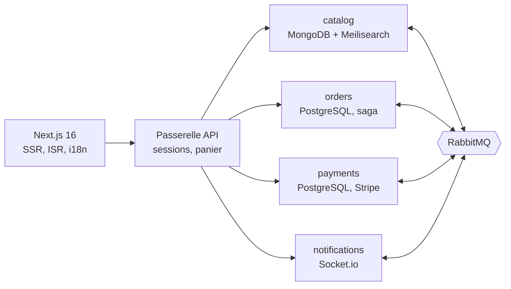

# SoukConnect

[](https://github.com/KarnasZiad/SoukConnect/actions/workflows/ci.yml)
[](https://github.com/KarnasZiad/SoukConnect/actions/workflows/security.yml)
[](LICENSE)

**Marketplace multi-vendeurs pour l'artisanat de Marrakech** — tapis, poterie, cuir. Chaque
artisan tient sa boutique ; l'acheteur commande auprès de plusieurs artisans en un seul paiement,
suit sa livraison et échange avec les vendeurs en temps réel, en français, en anglais ou en arabe.

> Projet de portfolio qui illustre une architecture distribuée réaliste : services Node.js reliés
> par RabbitMQ, saga de commande avec outbox et inbox, cohabitation SQL et NoSQL justifiée,
> paiement Stripe idempotent, front Next.js rendu côté serveur en trois langues.

**État** : conception, socle (contrats, messagerie, socle des services), catalogue, commandes, paiements et passerelle terminés ;
les autres services suivent lot par lot, chacun par pull request ([feuille de route](#feuille-de-route)).

## Sommaire

- [Fonctionnalités](#fonctionnalités)
- [Architecture](#architecture)
- [Démarrage rapide](#démarrage-rapide)
- [Documentation](#documentation)
- [Feuille de route](#feuille-de-route)

## Fonctionnalités

| Pour       | Fonctionnalité                                                                              |
| ---------- | ------------------------------------------------------------------------------------------- |
| Visiteurs  | Catalogue en FR, EN et AR (droite à gauche), recherche à facettes tolérante aux fautes      |
| Acheteurs  | Panier invité puis fusionné, commande multi-vendeurs, paiement Stripe, suivi en temps réel  |
| Artisans   | Boutique, produits aux attributs propres à chaque catégorie, stock, commandes, statistiques |
| Plateforme | Commission par vendeur, grand livre des ventes, messagerie acheteur-vendeur                 |

## Architecture



| Décision                                                                                                | Pourquoi                                                                    |
| ------------------------------------------------------------------------------------------------------- | --------------------------------------------------------------------------- |
| [Services par capacité métier + RabbitMQ](docs/adr/0002-microservices-et-rabbitmq.md)                   | Le catalogue reste disponible quand le paiement ne l'est pas                |
| [MongoDB, PostgreSQL, Redis, Meilisearch](docs/adr/0003-cohabitation-sql-nosql.md)                      | Attributs variables d'un côté, argent et transactions ACID de l'autre       |
| [Saga orchestrée, outbox et inbox](docs/adr/0004-saga-orchestree-outbox-inbox.md)                       | Ni stock bloqué sans paiement, ni paiement sans stock, ni double traitement |
| [Sessions côté serveur, jetons internes EdDSA](docs/adr/0006-passerelle-sessions-et-jetons-internes.md) | Révocation immédiate ; les services ne font confiance qu'à une signature    |
| [Next.js : ISR et i18n FR/EN/AR](docs/adr/0008-nextjs-isr-et-i18n.md)                                   | Référencement, Lighthouse > 95, arabe en RTL                                |

| Couche     | Technologies                                                                  |
| ---------- | ----------------------------------------------------------------------------- |
| Front      | Next.js 16, React 19, next-intl, Tailwind CSS 4, Stripe Elements, Socket.io   |
| Services   | Node.js 22, Fastify 5, Zod 4 → OpenAPI 3.1, amqplib, Pino                     |
| Données    | PostgreSQL 17, MongoDB 8 (jeu de réplicas), Redis 7, Meilisearch 1.54         |
| Messagerie | RabbitMQ 4.3 : échange topic, files quorum, nouvelles tentatives, quarantaine |
| Tests      | Vitest, Testcontainers, Playwright                                            |
| Livraison  | Turborepo, Docker, Kubernetes (Ingress NGINX), GitHub Actions, CodeQL, Trivy  |

## Démarrage rapide

Prérequis : Node.js 22, Docker et pnpm via Corepack (`corepack enable`).

```bash
pnpm install
cp .env.example .env
docker compose up -d          # PostgreSQL, MongoDB, Redis, RabbitMQ, Meilisearch, Mailpit
```

| Outil local        | Adresse                                  |
| ------------------ | ---------------------------------------- |
| RabbitMQ (console) | http://localhost:15672 (`souk` / `souk`) |
| Meilisearch        | http://localhost:7700                    |
| Mailpit (e-mails)  | http://localhost:8025                    |

## Documentation

- [Cahier des charges](docs/cahier-des-charges.md) et [user stories](docs/user-stories.md)
- [Architecture C4](docs/architecture/c4.md), [saga de commande](docs/architecture/saga.md),
  [messagerie](docs/architecture/messaging.md), [modèle de données](docs/database.md)
- [Décisions d'architecture (ADR)](docs/adr/0001-enregistrer-les-decisions-d-architecture.md)
- [Modèle de menaces STRIDE](docs/security/threat-model.md), [politique de sécurité](SECURITY.md)
- [Contribuer](CONTRIBUTING.md)

## Feuille de route

- [x] **L0** — Conception : cahier des charges, user stories, C4, saga (UML), données, ADR, menaces
- [x] **L1** — Contrats d'événements, messagerie (outbox, inbox, reprises), socle des services
- [x] **L2** — Catalogue et recherche, réservation de stock
- [x] **L3** — Commandes et saga
- [x] **L4** — Paiements Stripe, webhooks, commissions
- [x] **L5** — Passerelle : comptes, sessions, panier, OpenAPI agrégé
- [ ] **L6** — Notifications : messagerie et suivi en temps réel, e-mails
- [ ] **L7** — Front Next.js : boutique, espace vendeur, FR/EN/AR
- [ ] **L8** — Playwright, Lighthouse CI, Kubernetes, prévisualisation par pull request
- [ ] Extensions : produits similaires, modération, carte de livraison (Leaflet), application mobile

## Licence

[MIT](LICENSE)
