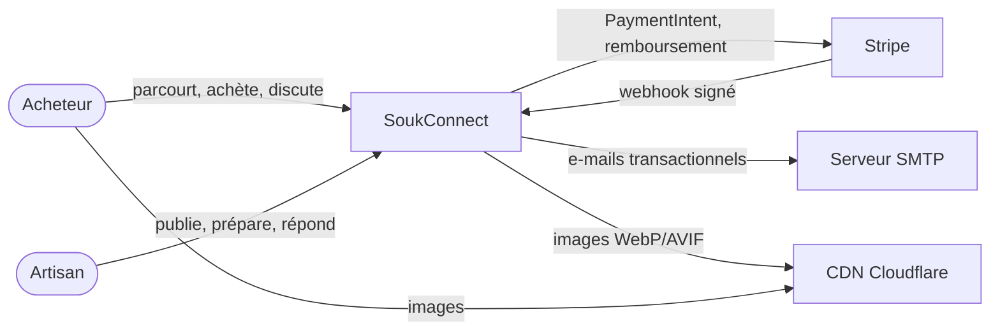
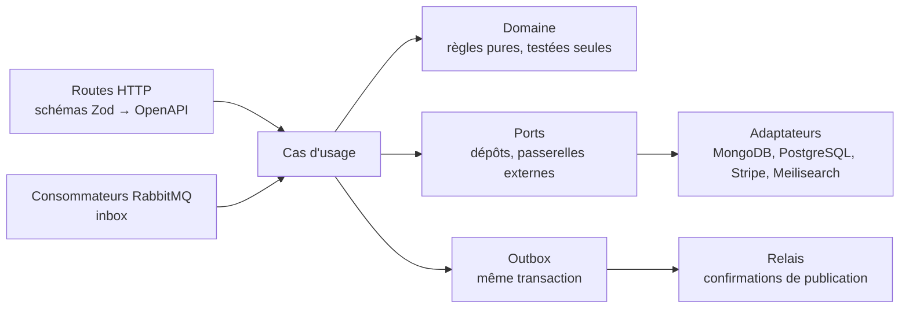

# Architecture — modèle C4

## Niveau 1 — Contexte



## Niveau 2 — Conteneurs

```mermaid
flowchart TB
  browser([Navigateur]) -->|HTTPS| ingress[Ingress NGINX]
  ingress -->|/| web[Web<br/>Next.js 16 : SSR, ISR, i18n]
  ingress -->|/api| gateway[Passerelle API<br/>Fastify : comptes, sessions, panier]
  ingress -->|/socket.io| notifications
  stripe[Stripe] -->|/api/webhooks/stripe| ingress
  web -->|lectures publiques, SSR| gateway

  gateway -->|HTTP + jeton interne EdDSA| catalog[Catalog<br/>Fastify]
  gateway --> orders[Orders<br/>Fastify, orchestrateur de saga]
  gateway --> payments[Payments<br/>Fastify, Stripe]
  gateway --> notifications[Notifications<br/>Fastify + Socket.io]

  gateway --- redis[(Redis<br/>sessions, panier, débit)]
  gateway --- gwdb[(PostgreSQL<br/>comptes)]
  catalog --- mongo[(MongoDB<br/>catalogue, réservations)]
  catalog --- meili[(Meilisearch<br/>index produits)]
  orders --- odb[(PostgreSQL<br/>commandes, saga)]
  payments --- pdb[(PostgreSQL<br/>paiements, grand livre)]
  notifications --- nmongo[(MongoDB<br/>conversations)]
  notifications --- redis

  catalog <-->|commandes, événements| mq{{RabbitMQ<br/>échange topic souk.events}}
  orders <--> mq
  payments <--> mq
  notifications <-- mq
```

| Conteneur     | Responsabilité                                                                         | Données                     | Mise à l'échelle                    |
| ------------- | -------------------------------------------------------------------------------------- | --------------------------- | ----------------------------------- |
| Web           | Pages publiques (SSR, ISR), espace acheteur et vendeur, trois langues                  | —                           | Horizontale, pages en cache         |
| Passerelle    | Seul point d'entrée de l'API : authentification, sessions, panier, limitation de débit | PostgreSQL (comptes), Redis | Horizontale, sans état local        |
| Catalog       | Boutiques, produits, stock et réservations, indexation et recherche                    | MongoDB, Meilisearch        | Horizontale ; lecture dominante     |
| Orders        | Commandes multi-vendeurs, orchestration de la saga, expéditions, statistiques vendeur  | PostgreSQL                  | Horizontale (verrous `SKIP LOCKED`) |
| Payments      | PaymentIntents Stripe, webhooks, remboursements, commissions, grand livre              | PostgreSQL                  | Horizontale                         |
| Notifications | Messagerie, suivi en temps réel (Socket.io), e-mails                                   | MongoDB, Redis (adaptateur) | Horizontale (adaptateur Redis)      |

## Règles de communication

- **Le navigateur ne parle qu'à la passerelle** (et à Socket.io avec un ticket émis par elle). Les
  services ne sont pas exposés : en Kubernetes, une `NetworkPolicy` n'accepte que la passerelle.
- **La passerelle signe un jeton interne** (JWT EdDSA, 60 s, audience = service) qui porte
  l'utilisateur et son rôle ; elle supprime tout en-tête d'identité venu du client
  ([ADR 0006](../adr/0006-passerelle-sessions-et-jetons-internes.md)).
- **Lectures synchrones, écritures asynchrones entre services** : la passerelle interroge les
  services en HTTP ; un service ne modifie jamais les données d'un autre, il lui envoie une
  commande ou réagit à ses événements par RabbitMQ ([ADR 0002](../adr/0002-microservices-et-rabbitmq.md)).
- **Chaque service possède ses données** : aucune base n'est partagée entre services.

## Niveau 3 — Composants d'un service

Tous les services suivent les mêmes couches :



Détails : [saga de commande](saga.md), [messagerie](messaging.md), [modèle de données](../database.md).
