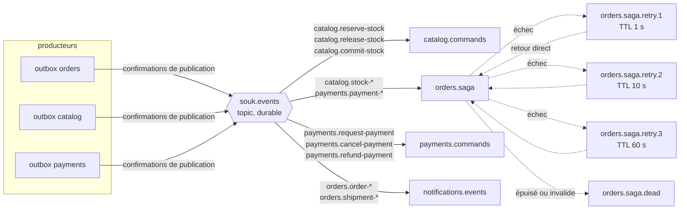

# Messagerie RabbitMQ

## Topologie

- **Un échange topic durable**, `souk.events`. La clé de routage est le type du message :
  `<service émetteur ou destinataire>.<nom>` (`catalog.reserve-stock`, `payments.payment-succeeded`).
- **Une file durable par service consommateur** (type _quorum_), liée aux seules clés qui le
  concernent. Les commandes (impératif : `reserve-stock`) ont un seul destinataire ; les événements
  (passé : `stock-reserved`) peuvent en avoir plusieurs.
- **Nouvelles tentatives différées** : en cas d'échec, le consommateur republie le message dans
  `<file>.retry.<n>` (TTL fixe, une file par délai pour éviter le blocage en tête de file) puis
  acquitte l'original. À l'expiration, le message revient **directement dans sa file d'origine**
  par l'échange par défaut, sans être redistribué aux autres services.
- **File de quarantaine** `<file>.dead` : message invalide (schéma), hors séquence, ou tentatives
  épuisées. Une alerte se déclenche dès qu'elle n'est pas vide ; le rejeu est manuel.

## Enveloppe

| Propriété AMQP           | Contenu                                                       |
| ------------------------ | ------------------------------------------------------------- |
| `messageId`              | UUID v7, clé de déduplication de l'inbox                      |
| `type`                   | Clé de routage, ex. `catalog.stock-reserved`                  |
| `correlationId`          | Identifiant de la commande : suit toute la saga dans les logs |
| `timestamp`              | Date de l'événement (pas de l'envoi)                          |
| `contentType`            | `application/json`                                            |
| `headers.x-attempts`     | Nombre de tentatives déjà faites                              |
| `headers.x-causation-id` | `messageId` du message qui a provoqué celui-ci                |

Le corps est validé par le schéma Zod du type (`packages/contracts`) avant tout traitement : un
producteur et un consommateur partagent le même schéma, versionné avec le monorepo.

## Garanties

| Problème                                | Mécanisme                                                                                                                              |
| --------------------------------------- | -------------------------------------------------------------------------------------------------------------------------------------- |
| Changement d'état sans message          | **Outbox** : le message est écrit dans la même transaction que l'état                                                                  |
| Message publié mais perdu par le broker | Files durables, messages persistants, **confirmations de publication** ; la ligne d'outbox n'est marquée publiée qu'après confirmation |
| Message traité deux fois                | **Inbox** : `messageId` inséré dans la transaction du traitement ; un doublon est acquitté sans effet                                  |
| Consommateur arrêté en plein traitement | Acquittement manuel après la transaction : le message est relivré                                                                      |
| Message toxique                         | Validation du schéma puis quarantaine, sans bloquer la file                                                                            |
| Débordement                             | `prefetch` borné par consommateur ; longueur des files surveillée                                                                      |

La livraison est donc **au moins une fois**, et le traitement **effectivement une seule fois**.
