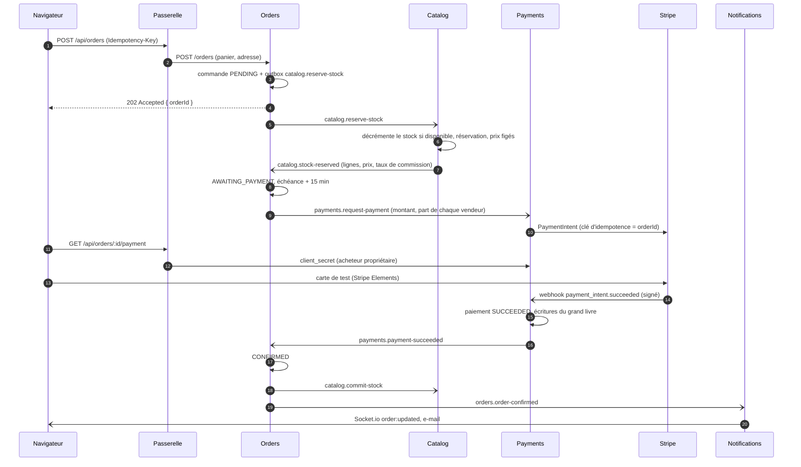
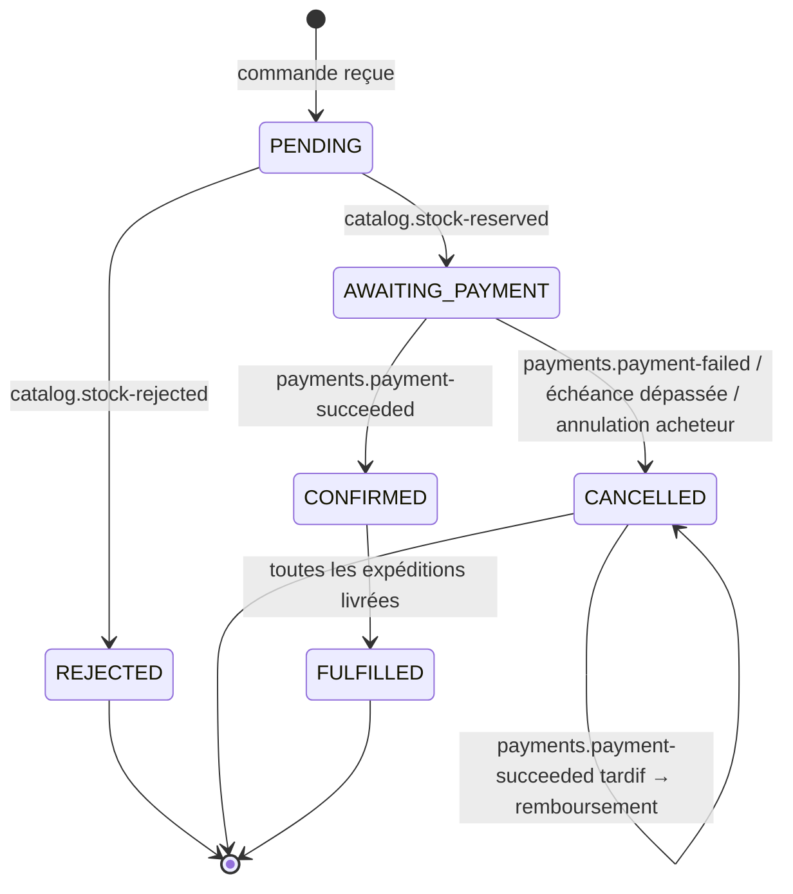

# Saga de commande

Une commande touche trois services qui ne partagent aucune base : le **stock** (catalog,
MongoDB), la **commande** (orders, PostgreSQL) et le **paiement** (payments, PostgreSQL). Une
transaction distribuée (2PC) est exclue ; la cohérence est obtenue par une **saga orchestrée** :
le service orders pilote les étapes et déclenche une compensation à chaque échec
([ADR 0004](../adr/0004-saga-orchestree-outbox-inbox.md)).

## Parcours nominal

Chaque flèche asynchrone (`-)`) est un message RabbitMQ écrit dans l'**outbox** du service émetteur
dans la même transaction que le changement d'état, puis publié par le relais : un changement d'état
sans message, ou un message sans changement d'état, est impossible.

## États de la commande

Chaque boutique d'une commande a sa propre **expédition** (`PREPARING → SHIPPED → DELIVERED`) :
un vendeur prépare ses pièces sans attendre les autres.

## Échecs et compensations

| Situation                                         | Réaction de l'orchestrateur                                                    |
| ------------------------------------------------- | ------------------------------------------------------------------------------ |
| Une pièce n'est plus disponible                   | `REJECTED` ; rien à compenser (le catalogue n'a rien réservé : tout ou rien)   |
| Paiement refusé (`payment_intent.payment_failed`) | `CANCELLED` ; `catalog.release-stock`                                          |
| Échéance de paiement dépassée (15 min)            | `CANCELLED` ; `catalog.release-stock` et `payments.cancel-payment`             |
| Paiement réussi **après** l'annulation            | La commande reste `CANCELLED` ; `payments.refund-payment` rembourse l'acheteur |
| Message reçu deux fois                            | Ignoré : l'inbox garde l'identifiant de chaque message traité                  |
| Message hors séquence (ex. paiement avant stock)  | Refusé par la machine à états, mis de côté (file `*.dead`) et journalisé       |
| Service indisponible                              | Les messages attendent dans sa file ; nouvelles tentatives à 1 s, 10 s, 60 s   |

## Règles qui rendent la saga sûre

- **Le prix vient du catalogue**, au moment de la réservation : le client n'envoie que des
  identifiants et des quantités.
- **La réservation est tout ou rien** : le catalogue décrémente tous les stocks dans une
  transaction MongoDB, ou aucun.
- **Un seul orchestrateur** : seul orders décide de l'état d'une commande ; les autres services
  exécutent des commandes et publient des faits.
- **Chaque transition est conditionnelle** (`UPDATE … WHERE status = 'AWAITING_PAYMENT'`) : deux
  messages concurrents ne peuvent pas faire avancer la même commande deux fois.
- **L'échéance est une ligne en base** balayée chaque minute avec `FOR UPDATE SKIP LOCKED` :
  plusieurs répliques d'orders ne traitent jamais la même échéance.
