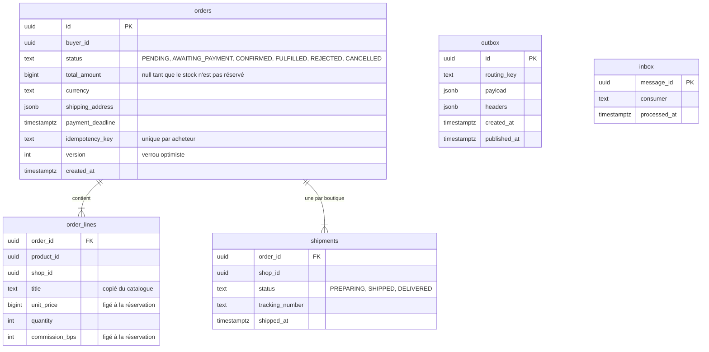
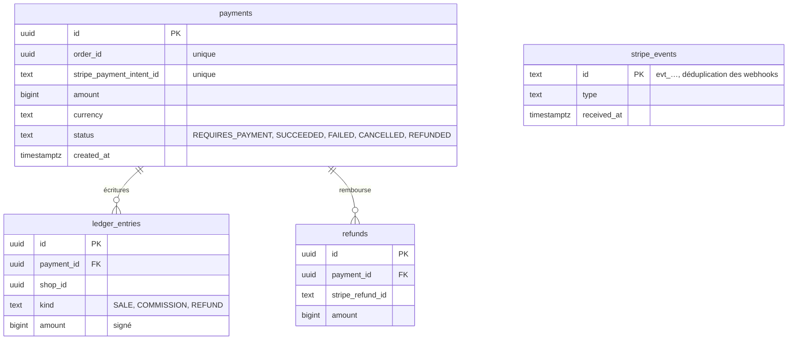

# Modèle de données

Chaque service possède sa base ; aucune jointure ni clé étrangère ne traverse deux services. Les
références entre services (`buyer_id`, `product_id`, `shop_id`) sont des identifiants opaques, et
les informations nécessaires à l'affichage sont **copiées** au moment de l'événement (titre et prix
d'une ligne de commande), pas relues plus tard.

Montants : **entiers en centimes de dirham** (`bigint`), devise `MAD`. Taux : **points de base**
(`1000` = 10 %).

## Orders — PostgreSQL



Index : `orders (buyer_id, created_at desc)`, `orders (payment_deadline) where status =
'AWAITING_PAYMENT'` (balayage des échéances), `order_lines (shop_id, order_id)` (espace vendeur),
`outbox (created_at) where published_at is null` (relais).

## Payments — PostgreSQL



Invariant contrôlé avant la validation de la transaction qui écrit le grand livre, et par les
tests : pour un paiement réussi, la somme des écritures `SALE` est égale au montant payé, et chaque
`COMMISSION` (négative) vaut `round(vente × taux / 10 000)`.

## Gateway — PostgreSQL

| Table            | Colonnes principales                                                                          |
| ---------------- | --------------------------------------------------------------------------------------------- |
| `accounts`       | `id`, `email` (unique, normalisé), `password_hash` (Argon2id), `role`, `locale`, `deleted_at` |
| `login_attempts` | `email_hash`, `ip_hash`, `failed_count`, `locked_until` (verrouillage progressif)             |

Sessions et paniers sont dans **Redis** : `sess:<sha256(id)>` (hash, TTL glissant de 7 jours),
`cart:<propriétaire>` (hash `productId → quantité`, TTL 30 jours).

## Catalog — MongoDB

```jsonc
// shops : une boutique par vendeur, dont l'identifiant est celui du compte du vendeur
{ "_id": "uuid du vendeur", "slug": "atelier-fatima", "name": "Atelier Fatima",
  "city": "marrakech", "description": { "fr": "…", "ar": "…" }, "status": "ACTIVE",
  "commissionBps": 1000 }

// products : attributs variables selon la catégorie, validés par un schéma Zod par catégorie
{ "_id": "uuid v7", "shopId": "uuid", "slug": "tapis-beni-ouarain-3f9a1c",
  "category": "rug", "title": { "fr": "Tapis Beni Ouarain", "en": "Beni Ouarain rug" },
  "description": { "fr": "…" }, "price": 450000, "currency": "MAD", "stock": 1, "sold": 0,
  "attributes": { "widthCm": 200, "lengthCm": 300, "material": "wool", "style": "beni-ouarain" },
  "images": [{ "url": "https://images.soukconnect.ma/…", "alt": { "fr": "…" } }],
  "status": "PUBLISHED", "publishedAt": "…", "updatedAt": "…" }

// reservations : une par commande, tout ou rien
{ "_id": "orderId", "status": "RESERVED | COMMITTED | RELEASED",
  "items": [{ "productId": "uuid", "quantity": 1 }], "createdAt": "…" }
```

Index : `products { shopId: 1, updatedAt: -1 }`, `products { slug: 1 }` unique, `shops { slug: 1 }`
unique. Le stock se décrémente par `updateOne({ _id, stock: { $gte: q } }, { $inc: { stock: -q } })`
dans une transaction (jeu de réplicas requis), avec l'insertion de la réservation, de l'inbox et de
l'outbox. Deux commandes concurrentes sur la dernière pièce : l'une des transactions échoue sur un
conflit d'écriture transitoire, le pilote la rejoue, et elle constate alors le stock épuisé.

Le slug d'un produit est fixé à la création (titre sans accents + 6 caractères de l'identifiant) et
ne change plus : une URL indexée par les moteurs reste valable. Les villes, catégories et matières
sont des listes fermées (`packages/contracts`) : un filtre de recherche n'est jamais du texte libre.

## Notifications — MongoDB

| Collection      | Contenu                                                                                                                                              |
| --------------- | ---------------------------------------------------------------------------------------------------------------------------------------------------- |
| `conversations` | `buyerId`, `shopId`, `productId`, `lastMessageAt`, compteurs de non-lus par participant ; unique par acheteur et boutique                            |
| `messages`      | `conversationId`, `authorId`, `body` (texte, 2 000 caractères au plus), `createdAt`                                                                  |
| `notifications` | `_id` = événement + destinataire (une seule par événement), `userId`, `type`, `orderId`, `readAt`, `emailedAt` ; TTL de 90 jours                     |
| `contacts`      | `_id` = compte, `email`, `displayName`, `locale` : écrits par la passerelle à l'inscription, effacés avec le compte, utilisés pour les seuls e-mails |

Les messages RabbitMQ ne portent aucune donnée personnelle : le service de notifications relit le
contact de chaque destinataire au moment d'envoyer l'e-mail.

## Recherche — Meilisearch

Index `products` : une entrée par produit publié, avec les textes des trois langues
(`title_fr`, `title_en`, `title_ar`), `category`, `city`, `material`, `price`, `shopId`,
`createdAt`. Attributs filtrables et facettes : `category`, `city`, `material`, `price`, `shopId`.
Tolérance aux fautes par défaut de Meilisearch (une faute à partir de 5 caractères, deux à partir de 9).
