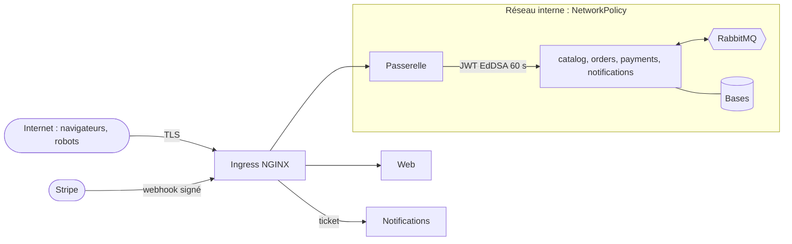

# Modèle de menaces (STRIDE)

## Actifs

| Actif                    | Pourquoi il compte                                                                 |
| ------------------------ | ---------------------------------------------------------------------------------- |
| Paiements et grand livre | Argent des acheteurs et des artisans ; une erreur se paie en remboursements        |
| Comptes et sessions      | Accès aux commandes, adresses et messages                                          |
| Données personnelles     | Adresses de livraison, e-mails, conversations (loi 09-08, RGPD)                    |
| Catalogue et stock       | Un stock falsifié vend des pièces inexistantes ; un prix falsifié ruine un vendeur |
| Clés                     | Stripe, signature des jetons internes, clé maître de Meilisearch                   |

## Frontières de confiance

## Menaces et mesures

| #   | STRIDE                 | Menace                                                            | Mesures                                                                                                                              |
| --- | ---------------------- | ----------------------------------------------------------------- | ------------------------------------------------------------------------------------------------------------------------------------ |
| S1  | Spoofing               | Vol de session, bourrage d'identifiants                           | Cookie `__Host-` `HttpOnly` `Secure` `SameSite=Lax`, rotation à la connexion, Argon2id, verrouillage progressif, limitation de débit |
| S2  | Spoofing               | Appel direct d'un service en se faisant passer pour la passerelle | Services non exposés (NetworkPolicy), JWT EdDSA vérifié sur chaque requête, audience par service                                     |
| S3  | Spoofing               | Faux webhook Stripe « paiement réussi »                           | Signature `Stripe-Signature` vérifiée sur le corps brut, tolérance de 5 min, état relu chez Stripe                                   |
| T1  | Tampering              | Prix ou total modifié par le client                               | Le client n'envoie que des identifiants et quantités ; prix figés par le catalogue à la réservation                                  |
| T2  | Tampering              | Modification du produit d'un autre vendeur (IDOR)                 | `shopId` tiré du jeton interne, jamais du corps ; filtre `shopId` sur chaque requête ; tests dédiés                                  |
| T3  | Tampering              | Message RabbitMQ forgé ou altéré                                  | Courtier interne, identifiants par service avec permissions limitées par vhost, schéma Zod à la réception                            |
| T4  | Tampering              | XSS stocké par une description de produit ou un message           | Rendu React échappé, jamais `dangerouslySetInnerHTML` sur du contenu utilisateur, CSP stricte avec nonce                             |
| R1  | Repudiation            | Vendeur ou acheteur conteste une commande ou un paiement          | Grand livre immuable (insertions seules), événements Stripe conservés, logs corrélés par commande                                    |
| I1  | Information disclosure | Lecture de la commande ou de la conversation d'un autre           | Contrôle de propriété dans chaque service ; ressource d'autrui = `404` ; tests d'autorisation                                        |
| I2  | Information disclosure | Fuite de la clé maître de Meilisearch                             | Clé détenue par catalog seul ; la recherche publique passe par l'API qui borne les paramètres                                        |
| I3  | Information disclosure | Données personnelles dans les logs ou les erreurs                 | Rédaction Pino (cookies, `authorization`, adresses) ; erreurs `problem+json` sans détail interne                                     |
| D1  | Denial of service      | Saturation de la recherche ou de la connexion                     | Limitation de débit par IP et par compte (Redis), pagination bornée, longueur des requêtes bornée                                    |
| D2  | Denial of service      | Réservation massive de stock sans payer                           | Réservation de 15 min, nombre de commandes en attente limité par acheteur, quantité ≤ stock                                          |
| D3  | Denial of service      | Message toxique qui bloque une file                               | Validation, quarantaine `*.dead` après 3 tentatives, `prefetch` borné                                                                |
| E1  | Elevation of privilege | Acheteur qui s'attribue le rôle vendeur ou modérateur             | Rôle lu en base par la passerelle, jamais accepté du client ; changement de rôle tracé                                               |
| E2  | Elevation of privilege | Dépendance compromise                                             | Lockfile figé, `pnpm audit`, Dependabot, revue des dépendances en PR, Trivy, images non root                                         |

## Paiement : règles non négociables

- **Aucune donnée de carte** ne transite par nos serveurs : Stripe Elements dans le navigateur.
- **Idempotence** : `Idempotency-Key` côté client pour créer la commande ; clé `orderId` pour le
  PaymentIntent côté Stripe ; table `stripe_events` pour les webhooks.
- **Source de vérité** : le webhook, jamais la redirection du navigateur.
- **Montant** : recalculé par payments à partir des lignes figées, comparé au PaymentIntent reçu.
